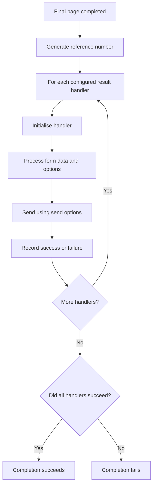

# Form configuration

The configuration files for the forms can be found in `app/forms/config`.

The name of the file represents the path that the form will be served on. For example, `app/forms/config/my-form.yml` will be available on `http://localhost:65514/my-form/`.

For details on the runtime models, routing, POST handling and validation, see
[Forms, flows and validation](./forms.md).

| Field          | Description                                                             |
| -------------- | ----------------------------------------------------------------------- |
| `startingPage` | The first page in the flow - this could be a static page or have a form |
| `finalPage`    | The last page in the flow that shows completion of the form             |
| `pages`        | An optional list of form pages to allow more complex flows              |

## Pages

A `startingPage`, `finalPage` and a page in `pages` share these fields:

| Field         | Description                                                                    |
| ------------- | ------------------------------------------------------------------------------ |
| `id`          | A unique identifer within the form, used by other pages to reference this one  |
| `name`        | The name of the page, used for the page title                                  |
| `slug`        | The page slug, to appear after the name of the config                          |
| `description` | An optional page description which may be used in the page body                |
| `template`    | An optional template to use for the page (defaults to `forms/form_page.html`)  |
| `form`        | A form to display, defined in `app/forms/parts` (not available on `finalPage`) |
| `fileHandler` | A configuration to handle any files uploaded in the form                       |

### Final page

The final page can have a `resultHandlers` list. When the flow is completed, each
handler is initialised, passed the submitted form data and reference number, then
sent using its configured options. A failed send or an exception is recorded as
a failure; the remaining handlers are still run. Completion succeeds only when
all configured handlers succeed.

```yaml
finalPage:
  # Other final-page fields
  resultHandlers:
    - type: email
      details:
        process:
          templateString: |
            New submission {{ reference_number }}
            Name: {{ data.contact.name }}
        send:
          to: team@example.com
          subject: New form submission
```

The handler receives a payload with submitted form responses under `data` and
the generated `reference_number`. A `templateString` is rendered with these
values available as Jinja variables. For a file-based template, use `template`
instead; it is rendered through Flask's template loader and receives the
processing values in its `data` variable.



#### Email result handler

Set `type: email` to send the result using Amazon SES. Under `details`, use:

| Option           | Location  | Description                                                                                                                                                |
| ---------------- | --------- | ---------------------------------------------------------------------------------------------------------------------------------------------------------- |
| `template`       | `process` | Name of a Flask template to render.                                                                                                                        |
| `templateString` | `process` | Inline Jinja template to render instead of a file-based template.                                                                                          |
| `html`           | `process` | Set to `true` to send the rendered content as HTML. Defaults to `false`, which sends it as plaintext. Make the template content match the selected format. |
| `to`             | `send`    | Recipient email address, or a list of addresses.                                                                                                           |
| `toVar`          | `send`    | Dotted path to a recipient address in the submitted data.                                                                                                  |
| `toConfigVar`    | `send`    | Application configuration key containing the recipient address.                                                                                            |
| `toFunction`     | `send`    | Dotted Python import path to a function that returns the recipient address. The function receives the handler data payload.                                |
| `subject`        | `send`    | Email subject. Defaults to `Form Submission`.                                                                                                              |
| `from`           | `send`    | Sender address. Defaults to the `DEFAULT_FROM_EMAIL` application setting.                                                                                  |

Recipient options are checked in the order `to`, `toVar`, `toConfigVar`,
`toFunction`; the first one that resolves to an address is used. If none
resolves, the `DEFAULT_INBOX` application setting is used. For example, to send
HTML, set `html: true` and provide HTML in the template:

```yaml
process:
  templateString: |
    <p>New submission {{ reference_number }}</p>
    <p>Name: {{ data.contact.name }}</p>
  html: true
send:
  toConfigVar: FORM_CONTACT_INBOX
  subject: New form submission
```

## `redirectWhenComplete`

Once the form on a given page is considered complete, you can redirect the user on to the next step in a number of ways:

```yaml
# Redirect to pizza_photo when the page is complete
redirectWhenComplete:
  - page: pizza_photo
```

```yaml
# Redirect to type_of_chocolate if the 'food' field is equal to 'chocolate'
redirectWhenComplete:
  - page: type_of_chocolate
    when:
      key: food
      value: chocolate
```

```yaml
# Redirect to a URL if the 'food' field is equal to 'no_food_just_cats'
redirectWhenComplete:
  - url: https://www.reddit.com/r/catpictures/
    when:
      key: food
      value: no_food_just_cats
```

If there are multiple completion redirects that equate to `True` then the first will be used.

## `requires`

Each page can require a list of other pages complete before it will allow you to access it.

If any of the prerequisite pages are not complete then the user will be redirected to it.

```yaml
# Redirect to pizza_topping if it is not complete
requires:
  - pizza_topping
```

## `requiresAny`

Some pages might be accessible from multiple other pages and the data might be different.

Each page can have a list of pages (`requiresAny`), when if any of which are complete the user is given the requested page.

```yaml
# Redirect to either pizza_photo or type_of_chocolate if neither are complete
requiresAny:
  - pizza_photo
  - type_of_chocolate
```

### `redirectIfNotComplete`

If none of the pages in the list are complete, the user will be redirected to `redirectIfNotComplete`.

If no `redirectIfNotComplete` is provided, the user will be redirected to the first incomplete page in the list.

```yaml
# Redirect to pizza_or_chocolate if both pizza_photo and type_of_chocolate are not complete
requiresAny:
  - pizza_photo
  - type_of_chocolate
redirectIfNotComplete: pizza_or_chocolate
```

## `requireResponse`

Some pages might only need to be accessed when a previous response matches an expected value.

If the value doesn't match the expected value, the user is redirected to that page.

```yaml
# Redirect to pizza_or_chocolate if the response to 'food' was not equal to 'chocolate'
requireResponse:
  - page: pizza_or_chocolate
    key: food
    value: chocolate
```
