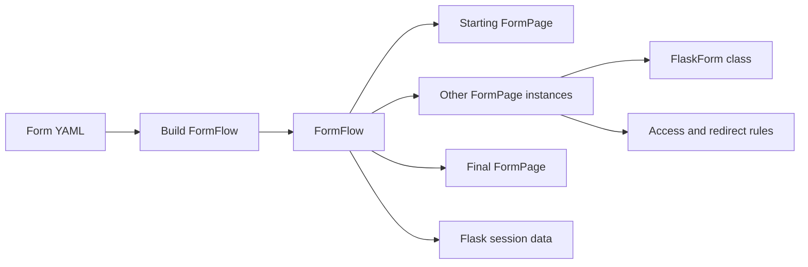
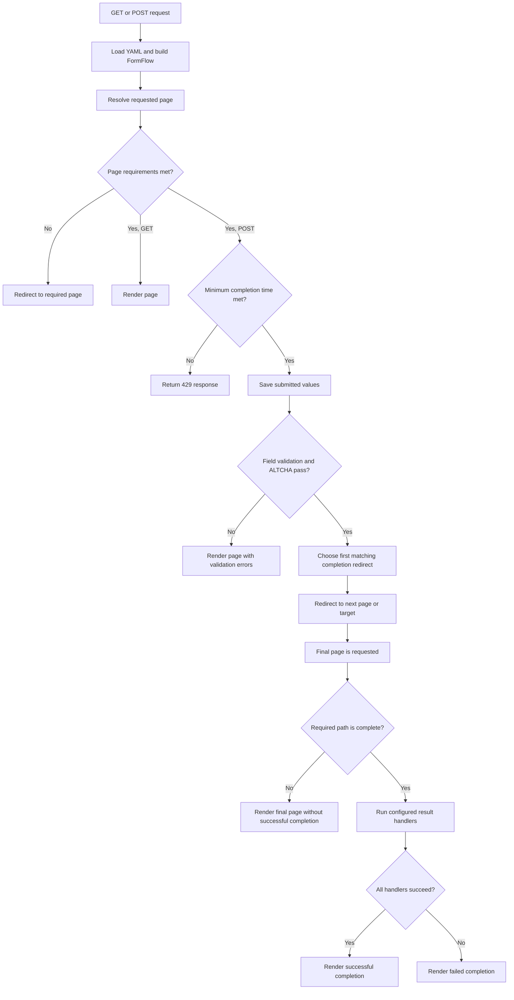

# Forms, flows and validation

Forms are described in YAML under `app/forms/config`. Each request loads the
configuration for the requested form and builds a `FormFlow` containing its
pages, rules and form classes. See the [configuration guide](./config.md) for
the YAML options.

## Runtime model

| Model                    | Responsibility                                                                                                                                                  |
| ------------------------ | --------------------------------------------------------------------------------------------------------------------------------------------------------------- |
| `FormFlow`               | Owns a form's pages, starting and final page, session data and completion handlers. It checks whether the required path to the final page is complete.          |
| `FormPage`               | Represents one routeable page. It holds the page's Flask-WTF form class, content, access requirements and completion redirects.                                 |
| `CompletionRedirectRule` | Represents a redirect after a valid submission. The target can be another page, a Flask endpoint or a URL; an optional condition selects when the rule applies. |
| `AltchaVerifier`         | Verifies optional ALTCHA proof-of-work challenges and rejects a previously solved challenge.                                                                    |



The `form` value in YAML names a `FlaskForm` class under
`app/forms/parts` (for example, `contact.RecordsEnquiry`). A page's `id` is
used to refer to it in rules and to key its responses in the session. Its
`slug` determines the page URL.

For example, the starting page below redirects to the final page after a valid
submission. The final page requires the starting page and sends one email:

```yaml
startingPage:
  id: contact
  name: Contact
  form: EmailForm
  redirectWhenComplete:
    - page: confirmation

finalPage:
  id: confirmation
  name: Thank you
  slug: complete
  requires:
    - contact
  resultHandlers:
    - type: email
      details:
        process:
          templateString: "Submission {{ reference_number }}"
        send:
          to: team@example.com
```

Responses are stored in the Flask session under the form path and page ID. The
flow data passed to completion handlers is shaped like this:

```python
{
    "page_id": {"field_name": "submitted value"},
    "another_page": {"another_field": "another value"},
}
```

The final page is not included in this response data. A configuration hash is
stored with the session state; if the form configuration changes, the existing
flow state is reset.

## Routing

The starting-page and page routes accept both `GET` and `POST` requests. The
reset route accepts `GET`:

| Route                       | Behaviour                                                                                                                        |
| --------------------------- | -------------------------------------------------------------------------------------------------------------------------------- |
| `/<form_path>/`             | Loads the form and serves its configured starting page. If the starting page has a different slug, redirects to that page's URL. |
| `/<form_path>/<page_slug>/` | Finds and serves the page with that slug.                                                                                        |
| `/<form_path>/reset/`       | Clears this form's session state and redirects to its starting page.                                                             |

An unknown form or page returns `404`. A configuration that cannot be loaded
or used to build a flow returns `500`.

Before a page is served, its access requirements are checked. If a required
page or response is missing, the user is redirected to the relevant page.
`requires` requires every listed page; `requiresAny` requires at least one;
`requireResponse` requires a field on a specified page to match a value. The
configuration guide describes these options and their fallbacks in detail.

For a valid form submission, the first matching `redirectWhenComplete` rule is
used. A rule without a `when` condition is unconditional. Add an unconditional
rule after conditional branches so that every valid submission has a target.
The target may be a page ID, a URL or a Flask endpoint specified with
`flaskMethod`.

## Request and completion flow



On the final page, result handlers receive the submitted responses and a
generated reference number. Their outcomes determine whether the completion
page is shown as successful. See [Final page result handlers](./config.md#final-page).
At least one result handler must be configured for the current completion check
to report success; an empty result list is treated as not handled.

## Validation

Field validation, page access requirements, anti-bot verification and
submission timing are separate checks:

| Check                   | Configuration or implementation                                          | Result                                                                                                                                                  |
| ----------------------- | ------------------------------------------------------------------------ | ------------------------------------------------------------------------------------------------------------------------------------------------------- |
| Field validation        | Validators on the configured WTForms fields                              | Invalid `POST` requests save the submitted values and render the same page with its validation errors. Valid submissions follow `redirectWhenComplete`. |
| Page access             | `requires`, `requiresAny` and `requireResponse`                          | A request for a page with unmet requirements is redirected to the prerequisite page.                                                                    |
| ALTCHA                  | `altcha: true` on a page                                                 | The submitted challenge must verify. A solved challenge cannot be reused.                                                                               |
| Minimum completion time | `minimumTimeToComplete` on a page, or `DEFAULT_MINIMUM_TIME_TO_COMPLETE` | A `POST` received too soon returns HTTP `429`. The page value is in seconds and overrides the application default.                                      |

Define field validation on the `FlaskForm` class referenced by the page. For
example:

```python
from flask_wtf import FlaskForm
from wtforms import EmailField, TextAreaField
from wtforms.validators import DataRequired, Email, Length


class ContactForm(FlaskForm):
    email = EmailField(
        "Email address",
        validators=[DataRequired(), Email()],
    )
    message = TextAreaField(
        "Message",
        validators=[DataRequired(), Length(max=1000)],
    )
```

Use WTForms validators such as `DataRequired`, `Email`, `Optional` and
`Length` to express each field's rules. `InputRequired` is not supported:
`FormPage` rejects a form class that uses it, including on nested form fields.
Use `DataRequired` for required values instead.

The `minimumTimeToComplete` setting is applied to form-page `POST` requests.
If omitted, the application-level `DEFAULT_MINIMUM_TIME_TO_COMPLETE` is used;
its default is zero seconds. ALTCHA verification is independent of the field
validators and is enabled per page.
